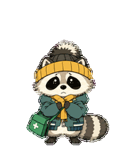

# Bryan 🦝

Bryan is a small, gray-brown raccoon who is always looking around with a wary expression. Wearing a knit hat and a dark green jacket and carrying a first-aid bag, he may look a little worse for wear, but he keeps trying his best.



This repository contains animated artwork for the **Pets plugin in ChatGPT Work mode**. Bryan can idle, move, wave, jump, react to failure, wait, think, and review, with additional frames for looking in different directions.

## Adopt Bryan

1. Sign in to your account in a ChatGPT Work environment that supports Pets, then open [Adopt Bryan](https://chatgpt.com/s/sharepet_6ae0368e7bc0819195ac42683ab3cd9d).
2. Follow the prompts to adopt the pet. The share link creates your own copy in your pet library, including its name, description, and complete animated sprite sheet.
3. Select the pet you just adopted and enable it. The original name in the share link may differ from the name on this page; you can rename your copy to **Bryan** after adoption. If your interface does not show an adoption button, send the following message in a conversation with access to the Pets plugin:

   > Please adopt and enable the pet from this share link: https://chatgpt.com/s/sharepet_6ae0368e7bc0819195ac42683ab3cd9d

The link works in environments that support ChatGPT Pets. Whether it appears in another Codex client depends on that client's Pets integration. This is not a standalone desktop application or a general-purpose Codex extension.

## Download

### Download the entire repository

Click **Code → Download ZIP** on this page and extract the archive, or clone it with Git:

```bash
git clone https://github.com/keichi333/bryan-raccoon-pet.git
```

After extracting or cloning, use `spritesheet.png` to create the pet. Keep the original PNG; do not replace it with a screenshot, crop it, compress it, or convert it to another image format.

### Download individual files

Open the [animation sprite sheet](spritesheet.png) and use GitHub's download button to save the original file. If your browser opens the image directly, save the original image rather than a preview thumbnail.

- [Animation preview GIF](preview.gif): for viewing the animations, not for import.
- [High-resolution character artwork](character.png): a still illustration without animation frames.

### Complete production materials

The [`materials/`](materials/) directory contains artwork, individual frames, previews, prompts, review reports, and production scripts for the original, revised-motion, and anime versions. Browse the directories directly, or download the complete repository using Git or **Download ZIP** as described above.

Account-specific pet IDs, temporary links, and local absolute paths have been redacted for public sharing. The older production scripts are provided for reference and may not run without modification. To use the pet directly, start with the adoption link above.

## Create and enable the pet from the sprite sheet

1. Sign in to a ChatGPT Work environment that supports the **Pets** plugin and make sure you can use it. Availability of the plugin and custom pets depends on your account and client.
2. Attach the downloaded `spritesheet.png` to a conversation, invoke or mention the Pets plugin, and send:

   > Please create a custom pet named Bryan using this complete, existing sprite sheet. Validate it first and use the original image without regenerating or modifying the artwork. After creating the pet, please enable it.

3. Complete any plugin authorization or confirmation requested in the conversation. The plugin needs to validate the image, upload it, and create the pet; the new pet must then be selected as active. If you only receive a preview, explicitly ask for creation and activation.
4. Return to the Work interface to see the pet. If it does not appear immediately, select **Bryan** again in the pet selector or reopen the client. Pets belong to individual accounts; downloading the file alone does not install one.

If your client does not provide the Pets plugin or custom pets, these files cannot run as a standalone desktop pet. Interface labels and entry points may change between versions. Do not copy the files into a guessed system directory; no API key is needed for this workflow.

## Troubleshooting

- **Image validation fails:** Use the original `spritesheet.png`, not the GIF, character artwork, or a screenshot. The original is a transparent PNG measuring **1536 × 2288** pixels.
- **The pet was created but does not appear:** Select the newly created pet as active and check that your client supports the feature.
- **The pet looks blurry:** Each animation cell is **192 × 208** pixels, and the character occupies only part of it. Enlarging the image can soften its outlines. The character illustration has a higher resolution but cannot replace the animated sprite sheet.
- **The download contains one large image:** This is expected. The sprite sheet arranges all animation frames in one image for the Pets plugin to interpret.

## Sprite sheet specification

The image uses the v2 layout: 8 columns by 11 rows, with **192 × 208** pixels per cell. The first nine rows contain idle, rightward movement, leftward movement, waving, jumping, failure, waiting, working/thinking, and review animations. The final two rows contain 16 look directions. Unused cells are transparent. Preserve the original dimensions and transparency.

## Usage and permissions

The artwork is publicly available in this repository for viewing and downloading. Additional permissions for use, redistribution, and commercial use have not been separately specified; contact the repository owner for clarification.
